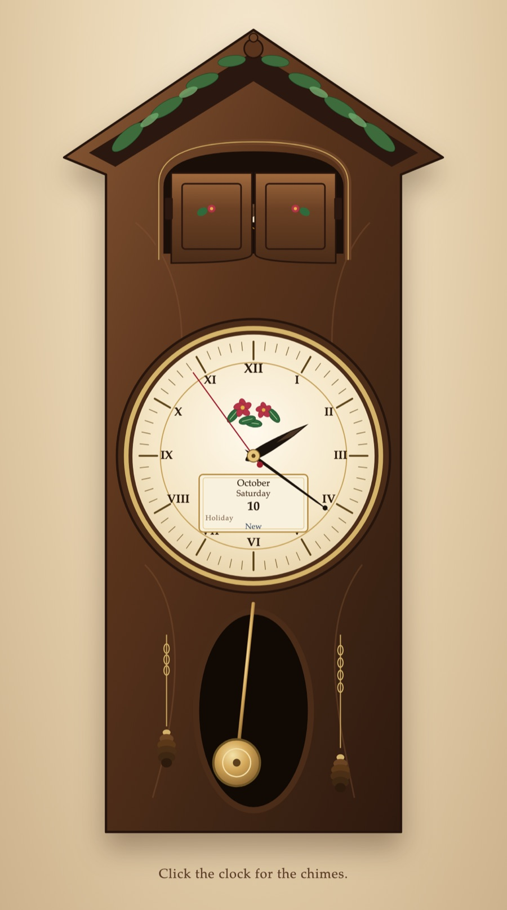

# Cuckoo Clock

An analog cuckoo clock in the browser. It keeps the computer's local time.

`./clock` installs what it needs, starts the app, and opens it.

Click the clock, or press a key, before the chimes play. The pendulum tics and toks. On the quarter hour it plays the Westminster phrase. On the hour it plays that phrase four times, then the cuckoo. A quarter that was already underway when the page opened is not replayed.

The window on the face shows the month, the weekday, the date, a holiday, and the moon. The holiday is Christmas, Christmas Eve, Thanksgiving, Presidents Day, or Easter. On every other day that line is blank.

`npm test` runs the tests.
